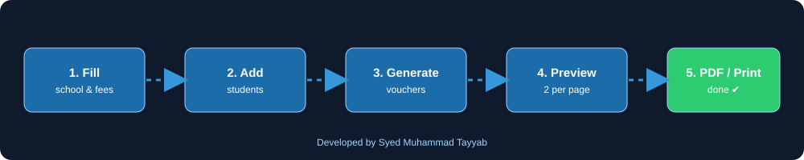
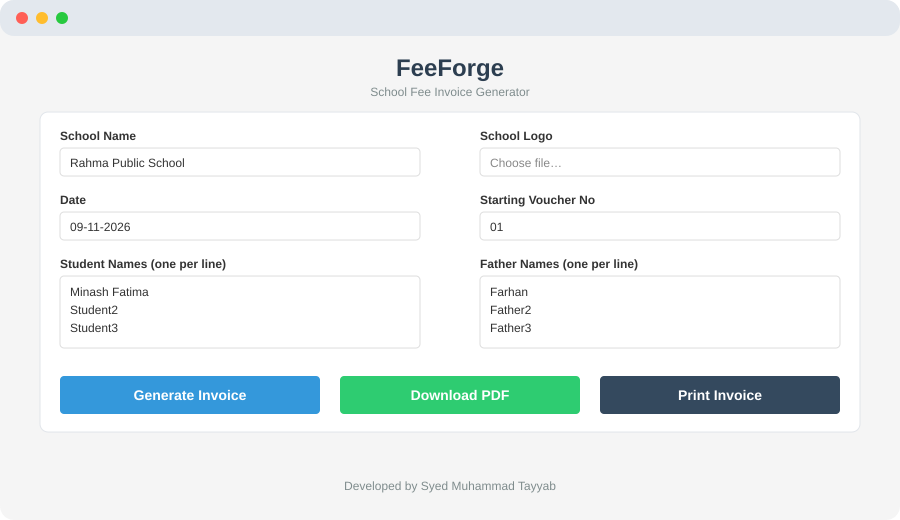
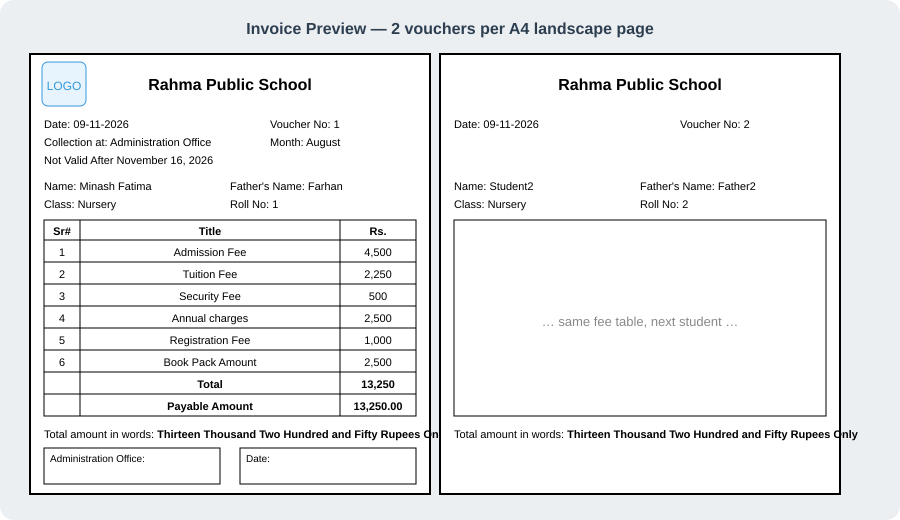
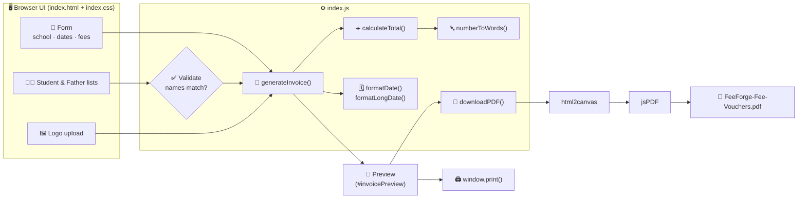
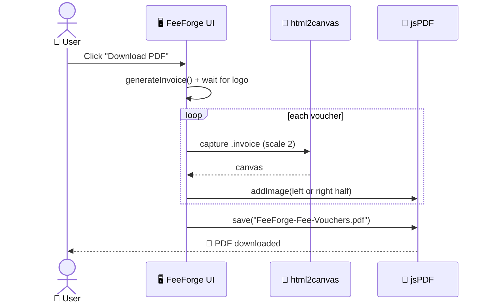

<div align="center">




<br/>

<a href="https://github.com/Syed-Muhammad-Tayyab/FeeForge">
  
</a>

<br/><br/>


<br/>

### ⚒️ **FeeForge** — *the fastest way to turn a list of students into print-ready school fee vouchers.*

<br/>

[🚀 **Live Demo**](https://syed-muhammad-tayyab.github.io/FeeForge/) &nbsp;•&nbsp;
[✨ **Features**](#-features) &nbsp;•&nbsp;
[🖼️ **Gallery**](#️-gallery) &nbsp;•&nbsp;
[⚙️ **How It Works**](#️-how-it-works) &nbsp;•&nbsp;
[📦 **Getting Started**](#-getting-started) &nbsp;•&nbsp;
[🗺️ **Roadmap**](#️-roadmap)

</div>

<br/>

---

<details>
<summary><h2>📑 Table of Contents</h2></summary>

- [📖 About](#-about)
- [✨ Features](#-features)
- [🖼️ Gallery](#️-gallery)
- [🧰 Tech Stack](#-tech-stack)
- [🏗️ Architecture](#️-architecture)
- [📂 Project Structure](#-project-structure)
- [🎨 Colour Palette](#-colour-palette)
- [⚙️ How It Works](#️-how-it-works)
- [📦 Getting Started](#-getting-started)
- [🧪 Usage Guide](#-usage-guide)
- [🚀 Deployment](#-deployment)
- [🗺️ Roadmap](#️-roadmap)
- [❓ FAQ](#-faq)
- [🤝 Contributing](#-contributing)
- [📜 License](#-license)
- [🙏 Credits](#-credits)
- [👨‍💻 Developer](#-developer)

</details>

---

## 📖 About

**FeeForge** is a lightweight, browser-based **school fee invoice (voucher) generator**. Type your school details once, paste a list of student and father names, set the fee heads — and FeeForge forges a clean, numbered voucher for **every student in one click**, ready to **print** or **download as a PDF**, two vouchers per A4 landscape page.

> No server. No database. No sign-up. No build step. Your data never leaves your browser. 🔒

### 🤔 Why FeeForge?

| 😩 The old way | ⚒️ The FeeForge way |
| :-- | :-- |
| Retyping a Word template for every student | Paste names once — all vouchers generated instantly |
| Manually counting voucher numbers | Auto-incrementing voucher & roll numbers |
| Converting totals to words by hand | Automatic amount in words (Lakh system, *Rupees Only*) |
| Fighting page breaks when printing | Print-tuned layout: **2 vouchers per A4 landscape** page |
| Installing heavy accounting software | Just open `index.html` |

<div align="center">

</div>

---

## ✨ Features

<table>
<tr>
<td width="50%" valign="top">

### 🧾 Voucher Engine
- ⚡ **Bulk generation** — one voucher per student, from a simple one-name-per-line list
- 🔢 **Auto voucher numbers** that increment from your starting number
- 🎓 **Roll-number prefix** support (e.g. `NUR-1`, `NUR-2` …)
- 🗓️ Smart date defaults — today's date and a *Not Valid After* date 7 days ahead
- ✅ **Input validation** — warns when student and father name counts don't match

</td>
<td width="50%" valign="top">

### 💰 Fee Handling
- 7 fee heads: Admission, Tuition, Security, Annual Charges, Registration, Book Pack, Other
- ➕ Automatic **total & payable amount** calculation
- 🔤 **Amount in words** — Lakh / Thousand / Hundred, ending in *Rupees Only*
- 🇮🇳 Indian/Pakistani digit grouping via `en-IN` (e.g. `1,25,000`)

</td>
</tr>
<tr>
<td width="50%" valign="top">

### 🖨️ Output
- 📄 **Download PDF** (jsPDF + html2canvas, 2× scale for crisp text)
- 🖨️ **Print** with dedicated `@media print` styles & `@page` A4 landscape
- 👀 Live **preview** before you print
- ✂️ Page-break control — vouchers never split across pages

</td>
<td width="50%" valign="top">

### 🏫 Branding & UX
- 🖼️ Upload your **school logo** (embedded as Base64 — no upload to any server)
- 🏷️ Editable school name, collection counter, month & more
- 📱 Fully **responsive** — works on phone, tablet and desktop
- 🔒 **Privacy-first** — everything runs locally in the browser

</td>
</tr>
</table>

---

## 🖼️ Gallery

<div align="center">

### 📝 The Input Form


<br/><br/>

### 🧾 The Generated Vouchers


<br/><br/>

<sub>*Illustrative previews generated for this README. Replace with real screenshots anytime: save them in `docs/assets/` and update the image paths above.*</sub>

</div>

---

## 🧰 Tech Stack

| Layer | Technology | Purpose |
| :-- | :-- | :-- |
| 🧱 **Markup** |  | Form + voucher structure |
| 🎨 **Styling** |   | Responsive layout, print styles |
| ⚙️ **Logic** |  | Calculation, number-to-words, DOM rendering |
| 📄 **PDF** |  | PDF document creation |
| 📸 **Capture** |  | Renders vouchers to images for the PDF |
| 🚀 **Hosting** |  | Free static hosting |

---

## 🏗️ Architecture



---

## 📂 Project Structure

```text
📦 FeeForge
├── 📄 index.html                  # App shell: form, preview area, script loading
├── 🎨 index.css                   # Layout, voucher styles, @media print rules
├── ⚙️ index.js                    # Calculations, number-to-words, voucher + PDF logic
├── 🖼️ icon.png                    # Favicon
├── 📚 docs
│   └── 🖼️ assets
│       ├── 🎞️ banner.svg          # Animated README banner
│       ├── 📝 preview-form.svg    # Form illustration
│       ├── 🧾 preview-voucher.svg # Voucher illustration
│       ├── 🔀 workflow.svg        # 5-step workflow graphic
│       └── 🖼️ icon.png
├── 🤖 .github
│   ├── ⚙️ workflows
│   │   └── 🚀 pages.yml           # Auto-deploy to GitHub Pages
│   ├── 🐞 ISSUE_TEMPLATE
│   │   ├── bug_report.md
│   │   └── feature_request.md
│   └── 📝 PULL_REQUEST_TEMPLATE.md
├── 🤝 CONTRIBUTING.md
├── 📜 CODE_OF_CONDUCT.md
├── ⚖️ LICENSE
├── 🙈 .gitignore
├── 🧹 .editorconfig
├── 🚫 .nojekyll
└── 📘 README.md
```

---

## 🎨 Colour Palette

| Swatch | Colour | Hex | Used for |
| :-: | :-- | :-- | :-- |
|  | Midnight Blue | `#2c3e50` | Headings, theme colour |
|  | Forge Blue | `#3498db` | **Generate Invoice** button |
|  | Emerald | `#2ecc71` | **Download PDF** button |
|  | Wet Asphalt | `#34495e` | **Print Invoice** button |
|  | Cloud | `#f5f5f5` | Page background |
|  | Ink | `#000000` | Voucher borders (print-friendly) |

---

## ⚙️ How It Works

<details open>
<summary><b>1️⃣ From form to vouchers</b></summary>

1. `generateInvoice()` reads every field, then splits the **Student Names** and **Father Names** textareas by line.
2. It validates that both lists are non-empty and **equal in length**.
3. `calculateTotal()` sums the seven fee heads; `numberToWords()` converts the total (Lakh system) and `toLocaleString('en-IN')` formats digits.
4. For each student it builds a voucher (with an incrementing **voucher number** and **roll number**) and groups them **two per `.invoice-pair`** so each pair maps to one A4 landscape page.
5. If a logo is uploaded, it is read as Base64 and injected into every voucher.

</details>

<details>
<summary><b>2️⃣ Download as PDF</b></summary>



Vouchers are placed **side by side** (two per landscape A4 page); a new page is added after every pair.

</details>

<details>
<summary><b>3️⃣ Print</b></summary>

`@media print` hides the form (`.no-print`), enforces `@page { size: A4 landscape; margin: 5mm }` and avoids page breaks inside a voucher. Use **Print Invoice** (or <kbd>Ctrl</kbd>+<kbd>P</kbd>) and choose *Margins: Default/None* and *Background graphics: on*.

</details>

<details>
<summary><b>4️⃣ Amount in words</b></summary>

| Input | Output |
| :-- | :-- |
| `13250` | Thirteen Thousand Two Hundred and Fifty Rupees Only |
| `125000` | One Lakh Twenty Five Thousand Rupees Only |
| `0` | Zero |

</details>

---

## 📦 Getting Started

### ✅ Prerequisites
Only a modern browser (Chrome, Edge, Firefox, Safari). An internet connection is needed once to load Bootstrap, jsPDF and html2canvas from their CDNs.

### 📥 Installation

```bash
# 1️⃣ Clone the repository
git clone https://github.com/Syed-Muhammad-Tayyab/FeeForge.git

# 2️⃣ Enter the project
cd FeeForge

# 3️⃣ Open it — that's it!
#    Double-click index.html, or serve it locally:
npx serve .
# or
python -m http.server 8000
```

Then visit **http://localhost:8000** (or the port shown).

---

## 🧪 Usage Guide

| Step | What to do |
| :-: | :-- |
| 1️⃣ | Enter the **School Name** and (optionally) upload a **logo** |
| 2️⃣ | Pick the **Date**, **Starting Voucher No**, **Collection at**, **Month** and **Not Valid After** date |
| 3️⃣ | Paste **Student Names** and **Father Names** — *one per line, same count* |
| 4️⃣ | Set the **Class** and an optional **Roll No Prefix** (e.g. `NUR-`) |
| 5️⃣ | Fill in the **fee heads** (use `0` for anything not applicable) |
| 6️⃣ | Click **Generate Invoice** to preview, then **Download PDF** or **Print Invoice** |

> 💡 **Tip:** The same fee amounts apply to every student in a batch. For different fee structures (e.g. another class), generate a new batch.

---

## 🚀 Deployment

### 🌐 GitHub Pages (automatic)

This repo ships with a ready-made workflow (`.github/workflows/pages.yml`).

1. Push the project to GitHub (branch `main`)
2. Go to **Settings → Pages → Build and deployment → Source: _GitHub Actions_**
3. Push any commit — your site goes live at:

```text
https://syed-muhammad-tayyab.github.io/FeeForge/
```

### ☁️ Other hosts
Because FeeForge is 100% static, it deploys as-is on **Netlify**, **Vercel**, **Cloudflare Pages** or any web server — no build command, publish directory is the repo root.

---

## 🗺️ Roadmap

- [x] Bulk voucher generation
- [x] Auto voucher & roll numbers
- [x] Amount in words (Lakh system)
- [x] Logo upload
- [x] Print-optimised A4 landscape layout
- [x] PDF download
- [ ] 🌙 Dark mode for the form
- [ ] 🔢 Preserve leading zeros in voucher numbers (e.g. `01`, `02`)
- [ ] 🧮 Support amounts in the Crore range
- [ ] 👥 Per-student fee overrides / concessions
- [ ] 📥 Import students from CSV / Excel
- [ ] 💾 Save & reuse school profiles (localStorage)
- [ ] 🛡️ Escape user input before rendering
- [ ] 🌍 Urdu / bilingual voucher template
- [ ] 📲 Installable PWA with offline mode

Have an idea? [Open a feature request](https://github.com/Syed-Muhammad-Tayyab/FeeForge/issues/new?template=feature_request.md) 💡

---

## ❓ FAQ

<details>
<summary><b>Is my students' data uploaded anywhere?</b></summary>
No. FeeForge runs entirely in your browser; nothing is sent to a server. Logos are read locally as Base64.
</details>

<details>
<summary><b>Why do I get "Number of student names must match number of father names"?</b></summary>
Both textareas must contain the same number of non-empty lines. Remove blank lines or add the missing names.
</details>

<details>
<summary><b>Can I use it offline?</b></summary>
The libraries (Bootstrap, jsPDF, html2canvas) load from CDNs, so the first load needs internet. Download them locally and update the `<script>`/`<link>` tags for fully offline use.
</details>

<details>
<summary><b>My PDF/print looks cut off — what should I do?</b></summary>
Print using **A4 · Landscape**, set margins to *Default* or *None*, and enable *Background graphics*.
</details>

<details>
<summary><b>What is the largest amount "amount in words" supports?</b></summary>
Currently up to 99 Lakh (99,99,999). Crore support is on the roadmap.
</details>

<details>
<summary><b>Can I change the currency or fee head names?</b></summary>
Yes — edit the labels in `index.html` and the voucher template inside `generateInvoice()` in `index.js`.
</details>

---

## 🤝 Contributing

Contributions make the open-source world awesome! 🌟

1. 🍴 **Fork** the project
2. 🌿 Create your branch: `git checkout -b feat/amazing-feature`
3. 💾 Commit: `git commit -m "feat: add amazing feature"`
4. 📤 Push: `git push origin feat/amazing-feature`
5. 🔀 Open a **Pull Request**

Please read [CONTRIBUTING.md](CONTRIBUTING.md) and the [Code of Conduct](CODE_OF_CONDUCT.md) first.

---

## 📜 License

Distributed under the **MIT License**. See [`LICENSE`](LICENSE) for details.

---

## 🙏 Credits

- 📄 [jsPDF](https://github.com/parallax/jsPDF) — PDF generation
- 📸 [html2canvas](https://html2canvas.hertzen.com/) — HTML → canvas capture
- 🎨 [Bootstrap](https://getbootstrap.com/) — responsive foundation
- 🖼️ Invoice icon — favicon asset bundled with the project
- 🌊 [capsule-render](https://github.com/kyechan99/capsule-render) & [readme-typing-svg](https://github.com/DenverCoder1/readme-typing-svg) — README decoration
- 🏷️ [Shields.io](https://shields.io/) — badges

---

## 👨‍💻 Developer

<div align="center">

<table>
<tr>
<td align="center">

### **Syed Muhammad Tayyab**
🎓 BSCS Student — Information Security · FUUAST Islamabad<br/>
💻 Web Development & Full-Stack · 🛡️ Cybersecurity

<br/>

[](https://github.com/Syed-Muhammad-Tayyab)

</td>
</tr>
</table>

### ⭐ If FeeForge saved you time, please give it a star!

<br/>

**Made with ❤️ and ☕ — Developed by Syed Muhammad Tayyab**


</div>
